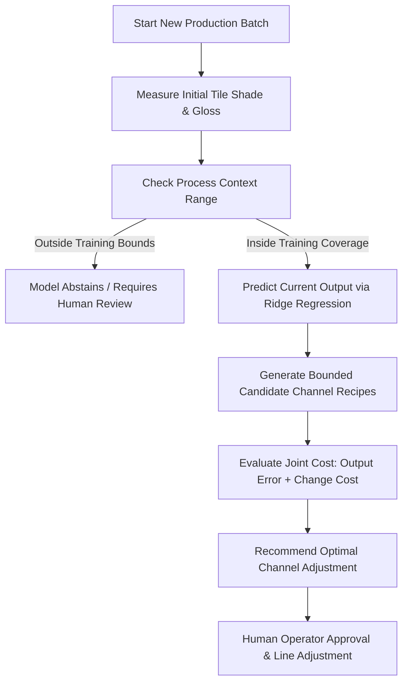

# Ceramic Tile Shade & Gloss Correction Demo

A dependency-free Python demonstration of automated batch-start tile shade ($L^*, a^*, b^*$) and gloss correction for ceramic manufacturing re-runs.

> **Note**: This repository contains synthetic data and fictional process models designed to demonstrate machine learning workflows, safety guardrails, and recommendation logic without requiring third-party libraries.

---

## 📌 Overview

In ceramic tile manufacturing, batch-to-batch process variations (such as kiln thermal shifts, body raw material tone changes, or glaze density fluctuations) cause off-shade tiles that do not match the target master sample.

This project demonstrates an end-to-end algorithmic correction workflow that:
1. **Predicts** tile color ($L^*, a^*, b^*$) and gloss metrics from 6 digital glaze dispenser channels and 3 process context parameters.
2. **Evaluates** model performance on unseen production batches using strict batch-level validation (preventing data leakage).
3. **Recommends** safe, bounded glaze channel recipe modifications to bring off-target batches back within target shade specifications.
4. **Enforces Safety Guardrails**, abstaining from recommendations if operating context exceeds training coverage or safe parameter limits.

---

## 📁 Repository Structure

| File | Description |
| :--- | :--- |
| [`shade_correction_stdlib_demo.py`](shade_correction_stdlib_demo.py) | **Core Module & Demo**: Synthetic process model, Ridge regression solver, batch dataset generator, model evaluation, and bounded recommendation engine. |
| [`test_shade_correction_stdlib_demo.py`](test_shade_correction_stdlib_demo.py) | **Unit Tests**: Test suite verifying batch split isolation, prediction metrics, safety bounds, error reduction, and failure handling. |

---

## 🛠️ Key Features

- 🐍 **Zero External Dependencies**: Built using only Python standard library modules (`math`, `random`, `dataclasses`, `unittest`).
- 🔒 **No Data Leakage**: Grouped batch-level train/test split guarantees entire production batches are held out for testing.
- 📐 **Custom Linear Algebra Solver**: Implements Ridge Linear Regression ($AX = B$) with Gaussian elimination and $L_2$ regularization from scratch.
- 🎯 **Bounded Recipe Recommendation**: Optimizes channel adjustments within safe limits ($\pm 12.0$ units) to prevent aggressive or unsafe line modifications.
- 🛡️ **Operational Guardrails**: Model detects out-of-range process context and abstains rather than making unvalidated predictions.

---

## 🚀 How to Run

### Prerequisites
- **Python 3.9+** (No `pip` packages required).

### 1. Run Unit Tests
To run the automated verification test suite:

```bash
python test_shade_correction_stdlib_demo.py
```
*(Or via unittest module: `python -m unittest test_shade_correction_stdlib_demo.py`)*

#### Expected Test Output:
```text
.....
----------------------------------------------------------------------
Ran 5 tests in 0.180s

OK
```

---

### 2. Run the Simulation Demo
To run the full synthetic training, evaluation, and batch correction simulation:

```bash
python shade_correction_stdlib_demo.py
```

#### Expected Demo Output:
```text
SYNTHETIC DEMO ONLY: values and results are fictional.
Train: 1296 samples / 54 batches; test: 432 samples / 18 batches
Held-out prediction errors:
  L*: RMSE=0.127, MAE=0.103
  a*: RMSE=0.108, MAE=0.087
  b*: RMSE=0.118, MAE=0.095
  gloss: RMSE=0.182, MAE=0.146

Example held-out batch correction:
  master target [L*, a*, b*, gloss]: [55.0, 1.0, 8.0, 65.0]
  current sample: [71.6, -11.6, 36.8, 70.8]
  recommended channels: [46.5, 52.8, 52.1, 46.5, 43.6, 47.5]
  simulated output after change: [54.33, -1.62, 7.57, 60.59]
  synthetic normalized error: 17.880 -> 2.008
  Production changes still require client validation and human approval.
```

---

## 📊 How the Model & Optimization Work



1. **Feature Input**: 
   - 6 Glaze Channel Dosages ($0 - 100$)
   - 3 Process Context Parameters (Kiln offset, Body tone offset, Glaze gloss offset)
2. **Prediction Targets**: 
   - Color ($L^*, a^*, b^*$) + Gloss
3. **Objective Optimization Function**:
   $$\text{Cost} = \sum_{i} \left(\frac{\hat{y}_i - y_i}{\text{Scale}_i}\right)^2 + 0.015 \cdot \sum_{j} \left(\frac{\Delta c_j}{\text{MaxChange}}\right)^2$$
